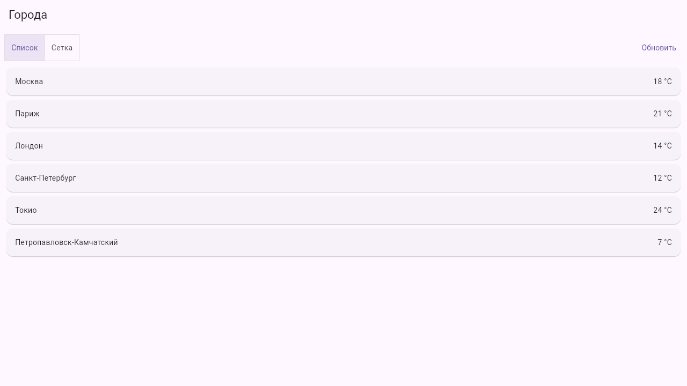
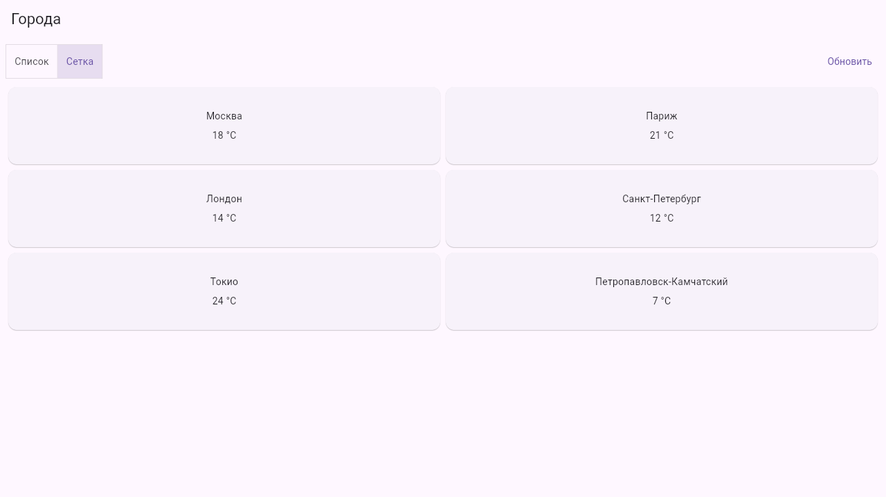
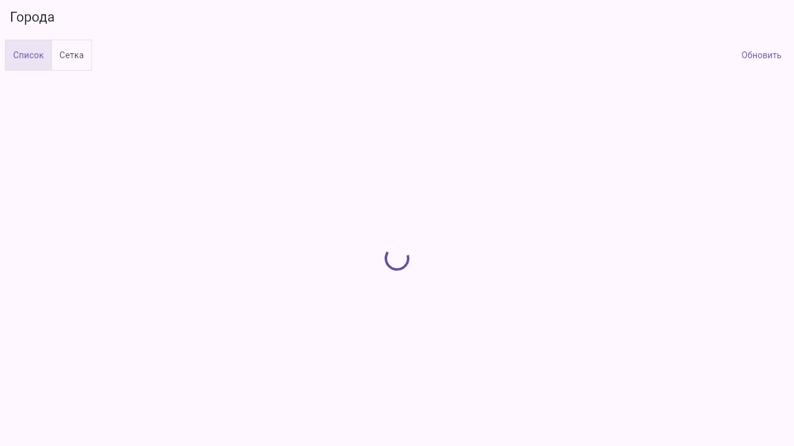
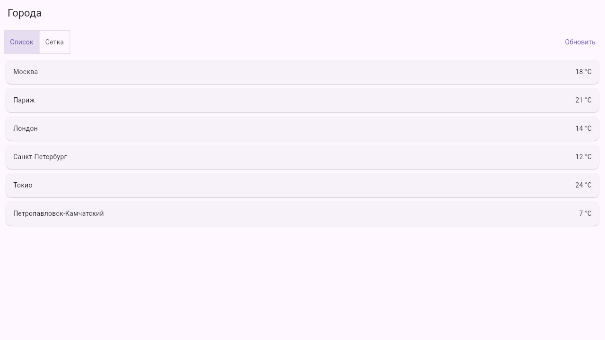
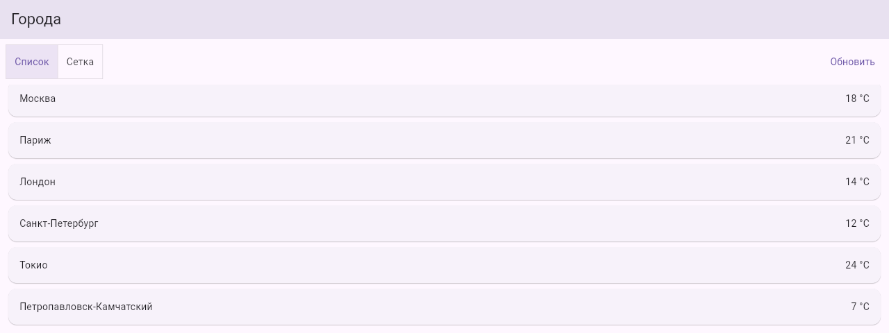
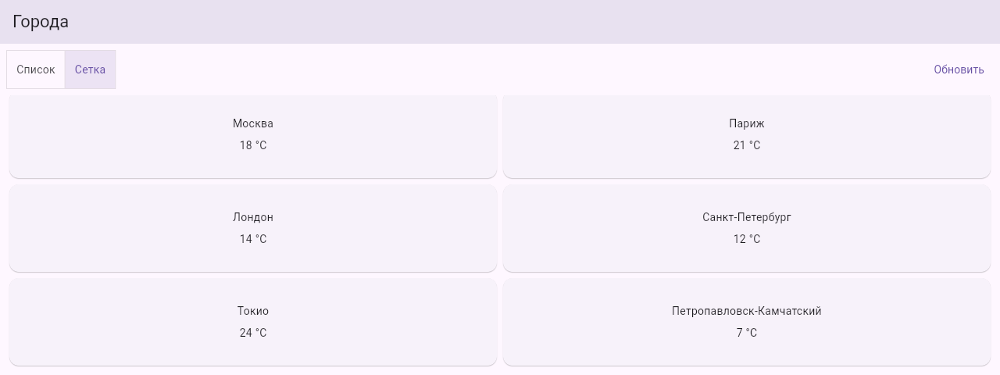

# Результат

Web версия в браузере на ПК, запуск `flutter run -d chrome`, окно 1280 на 720.

## Видео

Первая загрузка, список и сетка, «Обновить» с индикатором, смена режима во время ожидания.


Тот же ролик в mp4: [demo.mp4](demo.mp4)

## Скриншоты

Список



Сетка



Ожидание при первом запуске



Ожидание после «Обновить»


Смена режима во время ожидания


Данные после ожидания в последнем выбранном виде



Окно высотой 480, прокрутка до последнего города





## Проверки

Полный вывод в [checks.txt](checks.txt).

```
flutter analyze
No issues found!

flutter test
All tests passed! (1)

flutter test test/behavior_check.dart
All tests passed! (8)
```
