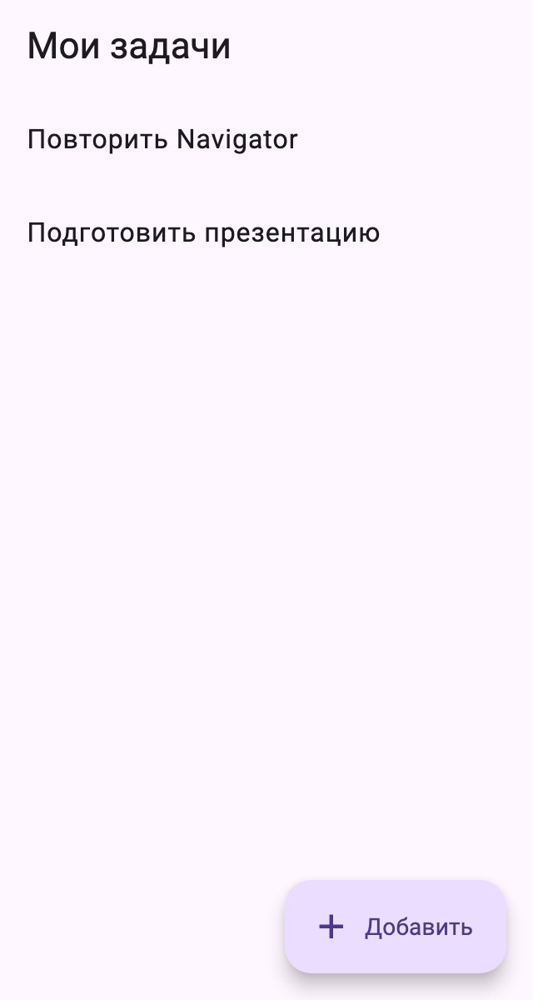
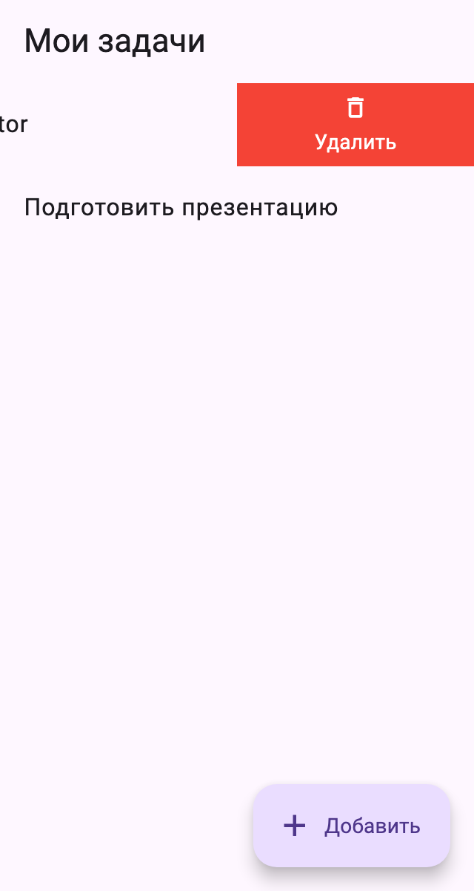
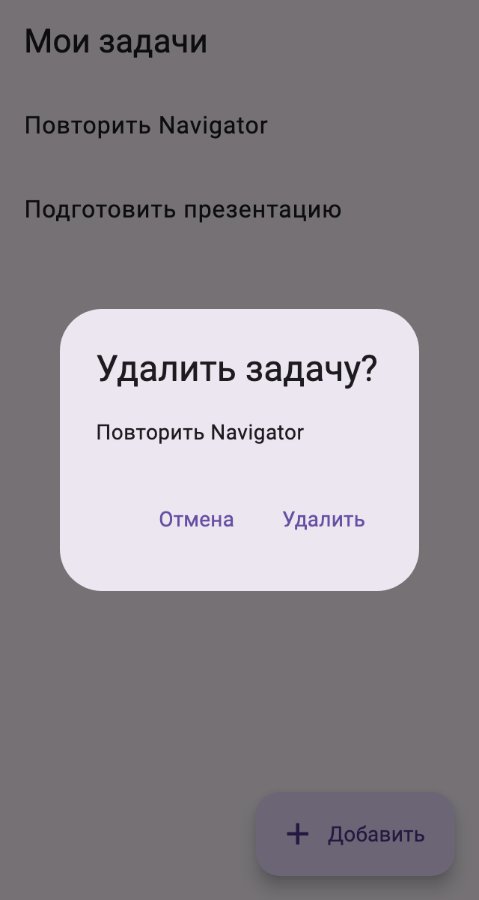

# Практика Flutter: Todo, навигация и диалог

За **80 минут** соберите приложение с двумя экранами: список задач и добавление новой задачи. Код приложения — в одном `lib/main.dart`, четыре TODO; при установке пакета также меняются `pubspec.yaml` и `pubspec.lock`. Проект запускается до выполнения задания.

Готовы `TodoItem`, две начальные задачи, счётчик id, точка входа, каркасы двух StatefulWidget и контроллер текстового поля с `dispose()`. Задачи живут в памяти `TodoPage`: после полного перезапуска снова появляются две исходные задачи. При установке пакета нужен доступ к pub.dev или заранее заполненный pub-кэш. Само приложение работает без API и БД.

## Запуск

Нужны [Flutter SDK](https://docs.flutter.dev/install) и Chrome. Проверено на Flutter 3.35.7 / Dart 3.9.2.

Склонируйте репозиторий или скачайте его через Code → Download ZIP:

```sh
git clone https://github.com/GeorgFed/flutter-todo-navigation-task.git
cd flutter-todo-navigation-task
```

Откройте папку с `pubspec.yaml`:

```sh
flutter pub get
flutter run -d chrome
```

Экран «Начните с TODO 1» — ожидаемый результат незаполненного шаблона. В терминале приложения: `r` — hot reload, `R` — hot restart, `q` — выход. SDK устанавливается заранее.

## Самостоятельно установите пакет

В шаблоне **нет flutter_slidable**. Для работы используйте совместимую с SDK курса версию:

```sh
flutter pub add flutter_slidable:4.0.3
```

Команда должна завершиться успешно и обновить `pubspec.yaml` / `pubspec.lock`. Затем сами добавьте импорт `package:flutter_slidable/flutter_slidable.dart` в main.dart и используйте виджет Slidable в списке. Сохраните оба pubspec-файла вместе с кодом. На Flutter 3.35.7 проверена именно версия 4.0.3.

Проверить установку отдельно:

```sh
flutter test test/package_check.dart
```

До установки пакета эти две проверки ожидаемо не проходят; обычный `flutter test` проверяет запуск незаполненного шаблона и проходит без пакета.

## Макет

Снимки готового приложения при ширине **320 logical px**, высоте 600. Стандартных виджетов и небольших отступов достаточно; точное совпадение цветов не требуется.

<table>
  <tr><th>Список</th><th>Добавление</th><th>Свайп</th><th>Подтверждение</th></tr>
  <tr>
    <td><a href="docs/screenshots/list.png"></a></td>
    <td><a href="docs/screenshots/add.png"></a></td>
    <td><a href="docs/screenshots/swipe.png"></a></td>
    <td><a href="docs/screenshots/delete.png"></a></td>
  </tr>
</table>

## Что реализовать

| TODO | Работа |
|---|---|
| **1 · Список и переход** | Самостоятельно соберите Scaffold, AppBar, кнопку «Добавить» и список. Каждую строку оберните в Slidable с устойчивым ключом по id; свайп справа налево открывает действие «Удалить». Оно вызывает deleteTodo(todo). «Добавить» открывает AddTodoPage через `MaterialPageRoute<String>`. Получите результат с await; после проверки mounted добавьте задачу только при ненулевом результате. Используйте `nextId++`, обновляйте список через setState. |
| **2 · Удаление** | Покажите AlertDialog с названием выбранной задачи. «Отмена» возвращает false, «Удалить» — true. После await удалите задачу по id только при true и актуальном mounted. |
| **3 · Сохранение** | Прочитайте `controller.text`, уберите пробелы по краям. Пустой текст: покажите errorText «Введите название» через setState и останьтесь в форме. Непустой: закройте экран с результатом String. |
| **4 · Экран добавления** | Scaffold с AppBar «Новая задача», TextField с подписью «Название» и кнопкой «Сохранить», вызывающей save. Подключите controller и errorText. Контент должен оставаться доступным при открытой клавиатуре. |

Для строки подходит ListTile с названием внутри Slidable. Как устроен Slidable, разберитесь сами по примеру в README пакета на [pub.dev](https://pub.dev/packages/flutter_slidable/versions/4.0.3). В callback действия вызовите уже написанный deleteTodo(todo). Для пустого списка покажите «Пока нет задач»; оставьте снизу место для кнопки «Добавить». **Сам свайп задачу не удаляет и диалог не открывает**: сначала появляется кнопка, затем тап открывает подтверждение. Автоматическое удаление полным свайпом не требуется. Названия могут повторяться, поэтому удаляйте конкретную задачу по id.

### Два результата ожидания

- `push<String>` возвращает **String?**: сохранение даёт название, обычный Back — null. При null список не меняется.
- `showDialog<bool>` возвращает **bool?**: подтверждение — true, отмена — false, закрытие без ответа — null. Удаление выполняется только при true. Для закрытия диалога используйте контекст его builder.

После await экран списка может быть удалён из дерева: перед setState проверьте mounted. Контроллер и его dispose уже подготовлены; простой ListView помогает разместить форму при появлении клавиатуры.

### Подсказка: TextField и контроллер

```dart
TextField(
  controller: controller, // связывает поле с State
  decoration: InputDecoration(
    labelText: 'Название',
    errorText: errorText, // null — ошибки нет, строка — показать её
  ),
)
```

Текущий ввод читается через `controller.text`, например `controller.text.trim()` в save. Чтобы показать или убрать ошибку, меняйте `errorText` внутри setState.

## Приёмка

1. «Добавить» → ввести название → «Сохранить»: экран закрылся, в списке появилась одна новая задача с обрезанными пробелами по краям.
2. Back из формы ничего не добавляет. Пробелы вместо названия дают сообщение «Введите название»; исправленный текст можно сохранить.
3. Свайп строки открывает «Удалить», список остаётся прежним. Тап по действию открывает диалог с нужным названием. «Отмена» и закрытие диалога через Back сохраняют список; «Удалить» убирает только выбранную задачу.
4. Одинаковые названия не мешают удалять задачи по одной. После удаления всех задач виден пустой экран, из него можно снова добавить задачу.
5. Пакет объявлен в dependencies, установлен, зафиксирован в lock-файле и реально используется в списке.
6. При ширине 320 и 800 px, длинном названии и открытой клавиатуре элементы доступны, overflow нет.

Проверить настройку и запуск незаполненного шаблона:

```sh
flutter analyze
flutter test
```

Проверить завершённую работу:

```sh
flutter test test/package_check.dart test/behavior_check.dart
```

Последняя команда ожидаемо не проходит до заполнения TODO. Тестовый файл менять не нужно. Проверки оценивают поведение; реализация может отличаться от примеров. Сохраните указанные названия кнопок и сообщений, чтобы самопроверка находила их.

## Оценивание · 0–2 балла

Оценка накопительная; критерии объявляются перед началом практики.

| Баллы | Проверяемый результат |
|---|---|
| **0** | Нет проверяемого сценария добавления задачи. |
| **1** | Самостоятельно собраны список и форма; непустая задача добавляется через результат Navigator, Back из формы не добавляет задачу. Студент объясняет этот сценарий. |
| **2** | Выполнен уровень 1; пакет установлен самостоятельно и сохранён в pubspec / lock; свайп открывает действие, тап — подтверждение; отмена и Back сохраняют задачу, подтверждение удаляет только выбранную по id. Пустой ввод обработан, после await есть mounted, проходят analyze и самопроверка, интерфейс доступен на узком экране. Студент объясняет результат Route / диалога и использование пакета. |

Оценивание UI: читаемость, доступность действий и отсутствие overflow. Точное совпадение оформления с макетом не требуется. Автотесты дополняют демонстрацию и объяснение кода.

Ориентир: 5 минут запуск, 5 установка пакета, 15 список и переход, 20 форма и результат, 10 диалог, 10 Slidable, 10 проверка, 5 объяснение. Это план, а не измеренное время новичка. Разрешены документация и примеры лекции; студент объясняет своё решение.

Результат: `main.dart`/commit, скриншоты двух экранов и диалога, короткая запись добавления/отмены/удаления, вывод самопроверки. Сдайте ссылку на репозиторий и точный commit, включая pubspec.yaml и pubspec.lock; приложите вывод проверок и короткое видео свайпа, подтверждения и отмены. Срок и канал сдачи преподаватель сообщает отдельно.

Документация: [flutter_slidable 4.0.3](https://pub.dev/packages/flutter_slidable/versions/4.0.3), [возврат результата](https://docs.flutter.dev/cookbook/navigation/returning-data), [текстовый контроллер](https://docs.flutter.dev/cookbook/forms/retrieve-input), [showDialog](https://api.flutter.dev/flutter/material/showDialog.html).
