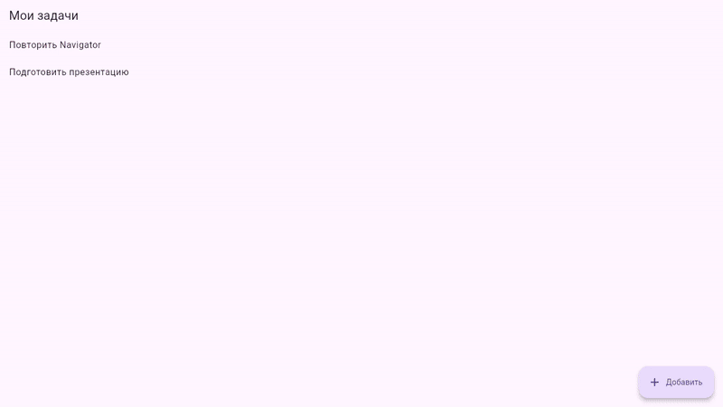
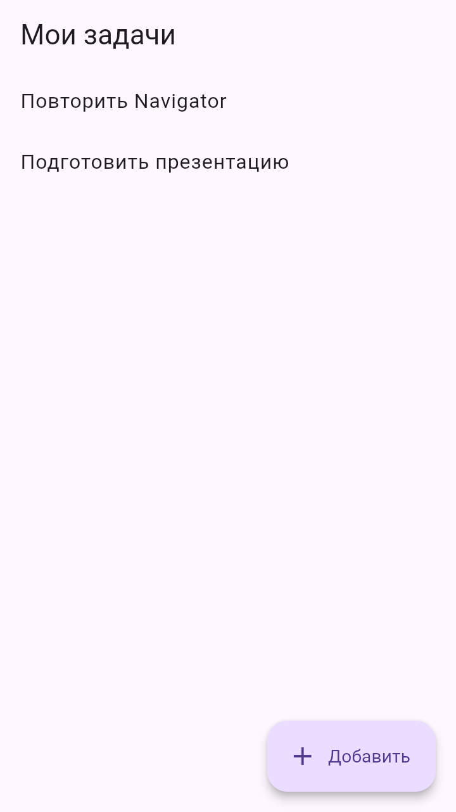
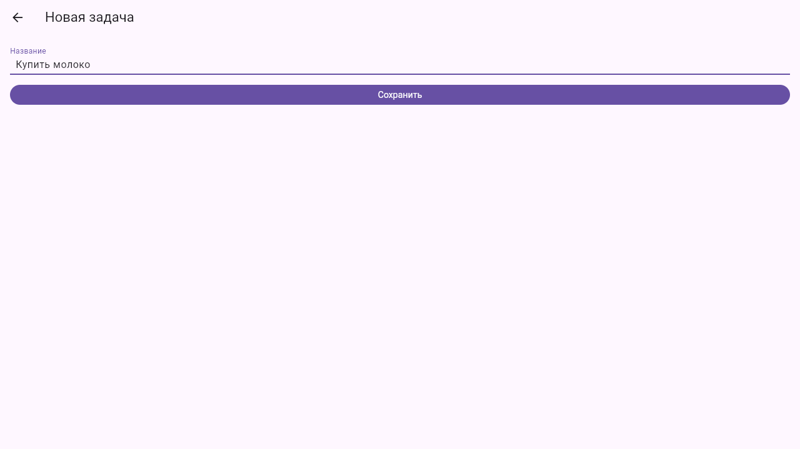
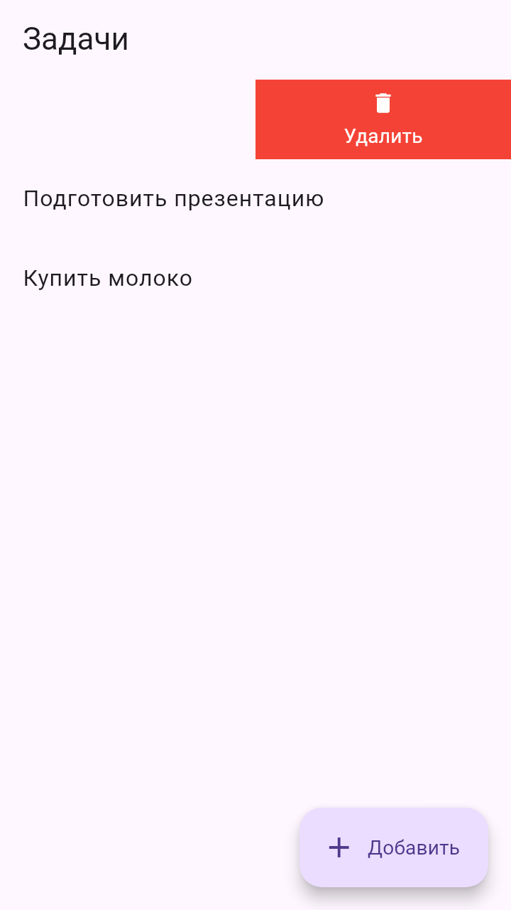
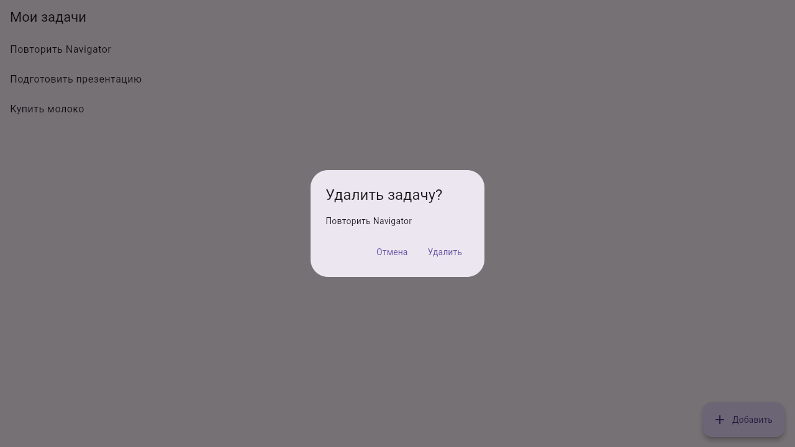
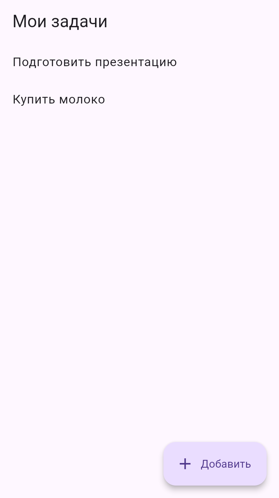

# Результат

Web версия, запуск `flutter run -d chrome`, окно 360 на 640.

## Видео

Добавление, пустой ввод, Back из формы, свайп, отмена, закрытие диалога, удаление.



Тот же ролик в mp4: [demo.mp4](demo.mp4)

## Скриншоты

| Список | Добавление | Пустой ввод |
|---|---|---|
|  |  |  |

| Свайп | Подтверждение | После удаления |
|---|---|---|
|  |  |  |

## Проверки

Полный вывод в [checks.txt](checks.txt).

```
flutter analyze
No issues found!

flutter test test/package_check.dart test/behavior_check.dart
All tests passed! (15)
```
